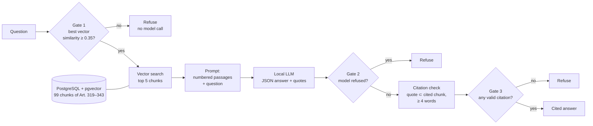

# Cited-answer RAG with measured evals

A question-answering API over Swiss employment-contract law that **answers only with verbatim, machine-checked citations** — or refuses. Retrieval and answer quality are **measured** on a hand-verified 40-question set, and CI fails if retrieval gets worse.

TypeScript · NestJS 12 · PostgreSQL 16 + pgvector · local embeddings (MiniLM) · local LLM via Ollama (`llama3.1:8b`) · Vitest · GitHub Actions

> **Not legal advice.** This is a demonstration of a retrieval and evaluation pipeline. The English text of Swiss law is an unofficial translation with no legal force (see [`corpus/SOURCES.md`](corpus/SOURCES.md)).

## The problem

A RAG system that "cites its sources" is only trustworthy if the citations are real and the system says "I don't know" when the sources don't cover the question. Both are usually assumed, not checked. This project checks them:

- **In code, at answer time:** every quote the model gives must appear word for word (after minimal normalisation) in the passage it cites; an answer with no valid citation is never returned.
- **Offline, with numbers:** how often retrieval finds the right article, how often the system answers or refuses correctly, and how faithful the answers are — including where it still fails.

## How it works



- **Corpus:** Swiss Code of Obligations, *The Individual Employment Contract*, Art. 319–343 (English), built reproducibly from the official source (`npm run corpus:build`).
- **Ingestion:** one chunk per article (long articles split at paragraphs), ≤ 250 tokens, embedded locally with `all-MiniLM-L6-v2`, stored in Postgres with an HNSW vector index and a full-text index.
- **Retrieval:** vector, keyword (Postgres full-text) and hybrid (reciprocal rank fusion) are all implemented behind one interface; `/ask` uses **vector**, chosen by the eval below.
- **Answering:** the model sees passages numbered `[1]..[5]` and must return JSON `{ answer, citations: [{ passage, quote }], refused }`. Code maps passage numbers to chunk ids and validates every quote. Model failures are retried once, then the API returns 503.

Details: [`docs/ARCHITECTURE.md`](docs/ARCHITECTURE.md). Every design choice, with rejected options and measurements: [`docs/DECISIONS.md`](docs/DECISIONS.md) (D1–D33).

## Results

All numbers come from real runs; the files are in [`eval/results/`](eval/results/) and can be regenerated with the commands below. Eval set: 40 questions — 30 answerable (15 worded casually, 15 in legal language) with a gold article, 10 not answerable from the corpus. Every gold reference was checked against the law text by hand ([`eval/VERIFICATION.md`](eval/VERIFICATION.md)).

**Retrieval** (30 answerable questions; hit@5 = right article in the top 5):

| Retriever | hit@1 | hit@5 | hit@5 casual / legal | MRR@10 |
|---|---|---|---|---|
| **vector** (used by `/ask`) | 18/30 | **29/30** | **14/15** / 15/15 | **0.754** |
| keyword | 15/30 | 20/30 | 5/15 / 15/15 | 0.566 |
| hybrid (RRF) | 16/30 | 25/30 | 10/15 / 15/15 | 0.670 |

With legal wording all three are perfect at hit@5; with casual wording keyword search fails, and fusing it in pulls hybrid below vector alone (D28).

**End to end** (`llama3.1:8b`, top 5 passages, gate-1 threshold 0.35, all 40 questions):

| Metric | vector (used) | hybrid |
|---|---|---|
| Right answer/refuse decision | 37/40 | 37/40 |
| Answerable questions refused | 2/30 | 1/30 |
| Unanswerable questions answered | 1/10 | 2/10 |
| Citations passing the verbatim check | 31/33 | 34/35 |
| Answers citing the gold article | 26/28 | 24/29 |
| LLM judge: supported / partial / unsupported | 17 / 9 / 3 | 16 / 9 / 6 |
| Seconds per question, median / max (laptop) | 8.9 / 19.6 | 7.5 / 14.7 |

**The judge was checked against a human:** on 15 blind-labelled answers, same verdict on 10/15, Cohen's kappa 0.46 (moderate). It made errors in both directions, so judge numbers are treated as a rough signal; the deterministic metrics (verbatim check, gold-citation rate) come first (D30).

**Refusal threshold:** at 0.35, gate 1 refuses 0/30 answerable questions and stops 5/10 unanswerable ones before the model; gates 2–3 stop 4 of the other 5. At 0.40 it would refuse 4 real (casually worded) questions (D29).

## Quickstart

Prerequisites: **Node.js 24**, **Docker**, and — only for answering questions — **[Ollama](https://ollama.com)** (~5 GB for the model).

```bash
git clone https://github.com/OmriNiri/cited-Rag-With-Evals.git
cd cited-Rag-With-Evals
npm ci
cp .env.example .env

docker compose up -d                 # Postgres 16 + pgvector; wait until `docker compose ps` says "healthy"
npm run ingest                       # chunk + embed the corpus (downloads MiniLM, ~90 MB, on first run)
npm run search -- "Can my employer fire me while I am sick?" --mode all   # retrieval only, no LLM

ollama pull llama3.1:8b              # the answer model (Ollama must be running)
npm run ask -- "How many weeks of holiday do I get?"   # full pipeline in the terminal
npm run start:dev                    # API on http://localhost:3000
```

## API

`POST /ask` with `{"question": "..."}`. A refusal is a normal result (200 with `refused: true` and the reason), not an error. Real responses:

**Cited answer**

```bash
curl -s -X POST localhost:3000/ask -H 'content-type: application/json' \
  -d '{"question":"How many days off can I take to look after my sick partner?"}'
```

```json
{
  "refused": false,
  "answer": "No more than three days per event and no more than ten days per year.",
  "citations": [
    {
      "passage": 1,
      "chunkId": "co-individual-employment-contract:art-329h:0",
      "article": "Art. 329h",
      "quote": "An employee is entitled to paid leave for the time he or she spends caring for a family member or life partner with health problems; however, the leave is limited to no more than three days per event and no more than ten days per year.",
      "valid": true
    }
  ]
}
```

**Refused before the model** (gate 1, answered in 0.09 s):

```jsonc
// {"question":"How do I bake sourdough bread?"}
{ "refused": true, "refusalReason": "low_retrieval_score", "answer": "", "citations": [] }
```

**Refused by the model** (gate 2 — on topic, but the passages do not answer it):

```jsonc
// {"question":"How much unemployment insurance will I receive?"}
{ "refused": true, "refusalReason": "model_insufficient_context", "answer": "", "citations": [] }
```

**Bad request** (400):

```jsonc
// {"question":""}
{ "message": "Body must be JSON like {\"question\": \"...\"} with a non-empty question", "error": "Bad Request", "statusCode": 400 }
```

If the model is unreachable or keeps failing after one retry, the API returns **503**. `GET /health` returns 200 when the database is reachable, 503 when not.

## Running the evals

```bash
npm run eval:retrieval                    # hit@k + MRR per retriever, threshold sweep (no LLM, seconds)
npm run eval:gate                         # the CI gate on those results (D33)
npm run eval:answers -- --mode vector     # full pipeline + LLM judge on all 40 questions (minutes)
npm run eval:judge-agreement              # judge vs the human labels in eval/JUDGE-CHECK.md
```

Results are written without timestamps, so rerunning with nothing changed gives an empty `git diff`.

## Tests and CI

```bash
npm test             # 182 unit tests — no database, no model, no network (the LLM is a fake)
npm run test:int     # integration tests against real Postgres in a temporary schema
npm run lint && npm run format:check
```

GitHub Actions runs three jobs on every push: lint/format/build/unit tests; integration tests with a Postgres service; and the **retrieval gate**, which ingests the corpus into a fresh database, re-runs the retrieval eval, and fails if the `/ask` retriever drops below hit@5 28/30, MRR@10 0.72, or refuses any answerable question at gate 1 (D33). On the first CI run, Linux reproduced every macOS rank exactly. The LLM eval is not in CI (it needs a local model).

## Limitations

- **A real quote can back a wrong answer.** "Can my employer fire me while I am sick?" is answered "No, the employer must provide care…" with a valid quote from Art. 328a — the right article (336c) is ranked 9th by vector search, outside the top 5. The verbatim check cannot catch this; the gold-citation metric does, the LLM judge did not (D26, D30).
- **Similarity is not answerability.** "Can an employer change my salary without my agreement?" is not answered by the corpus but scores 0.552 — higher than 12 of the 30 answerable questions — and the model answers it. Only a threshold of 0.60 would block it, refusing 14/30 answerable questions (D29).
- **Thin threshold margin.** The lowest answerable question scores 0.366 and the highest blocked unanswerable one 0.329; a new casually worded question could be refused.
- **Small eval, no held-out set.** 40 questions; one question is 3.3 points of hit@5. The vector-vs-hybrid difference (4 questions, all in favour of vector) is not statistically significant (p ≈ 0.125). The same set was used to choose the retriever and threshold and to report them.
- **Self-judging.** The judge is the same 8B model that answers; its agreement with one human on 15 answers is moderate (kappa 0.46), and that human was not fully blind (D30).
- **One corpus, one language, one model.** The questions were drafted with an AI coding agent and verified by hand, not collected from real users.

Full list with reasons: D32 in [`docs/DECISIONS.md`](docs/DECISIONS.md).

## Project layout

```
src/
  ingestion/  retrieval/  answering/  evaluation/   business logic, each with its interfaces
  infrastructure/                                   config, Postgres, embeddings, LLM client
  cli/                                              ingest, search, ask, eval:* entry points
test/          integration tests + helpers
scripts/corpus reproducible corpus build
corpus/        generated plain-text corpus + SOURCES.md
eval/          questions.jsonl, VERIFICATION.md, JUDGE-CHECK.md, results/
docs/          ROADMAP, ARCHITECTURE, DECISIONS
```

## License

Code: [MIT](LICENSE). Corpus: Swiss official enactments and their official translations are not protected by copyright (Art. 5 Swiss Copyright Act; see [`corpus/SOURCES.md`](corpus/SOURCES.md)).
